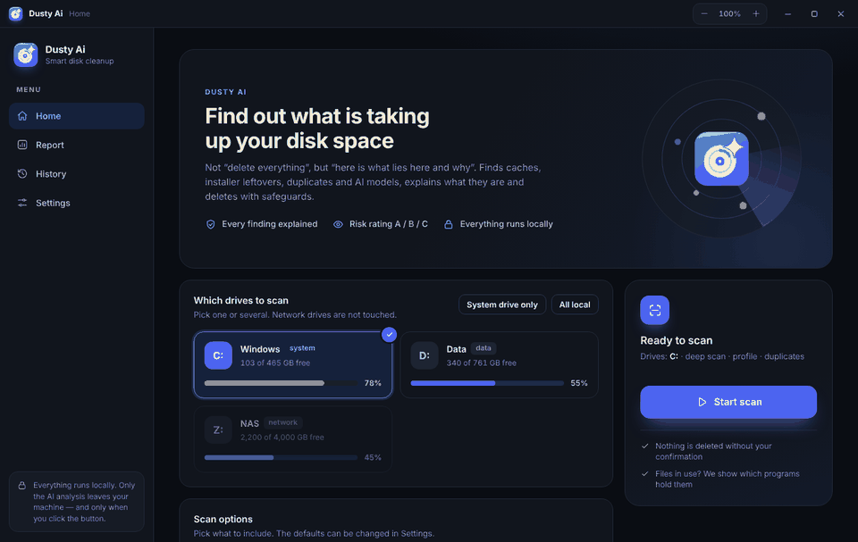
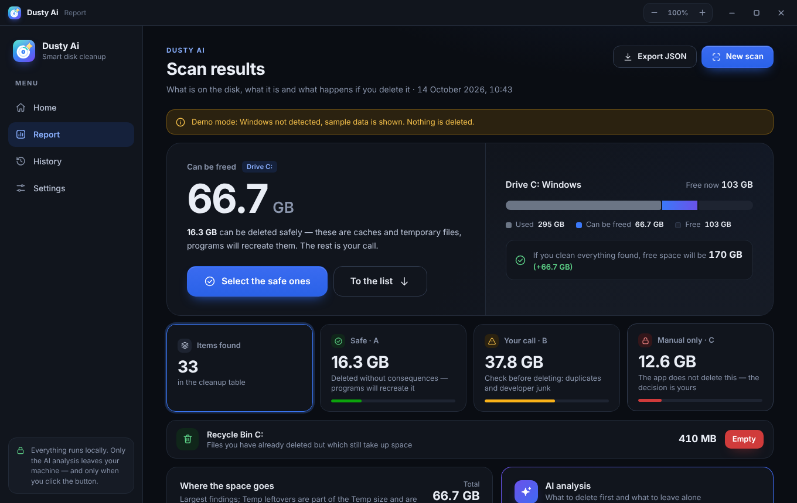
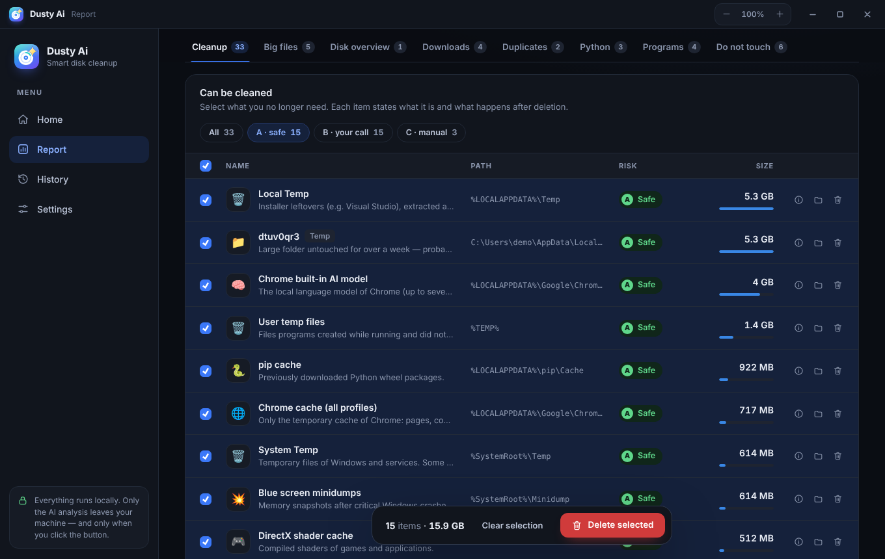
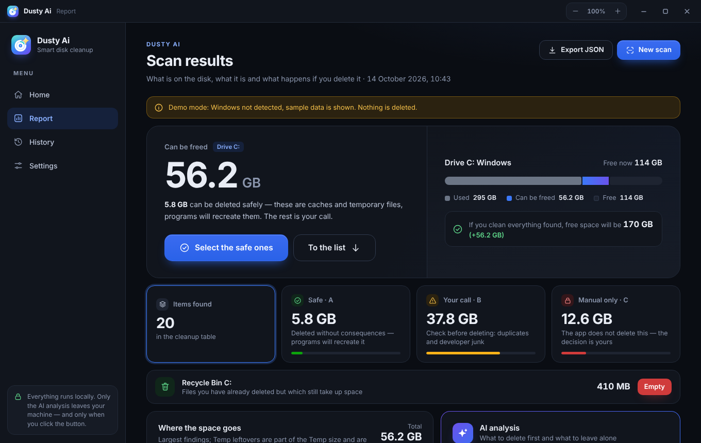
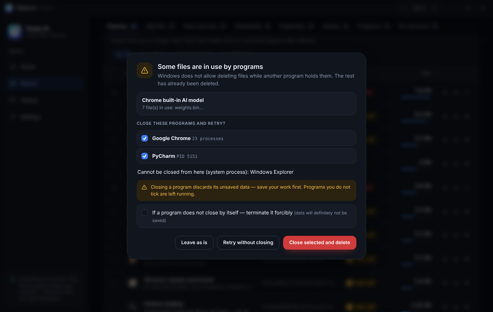
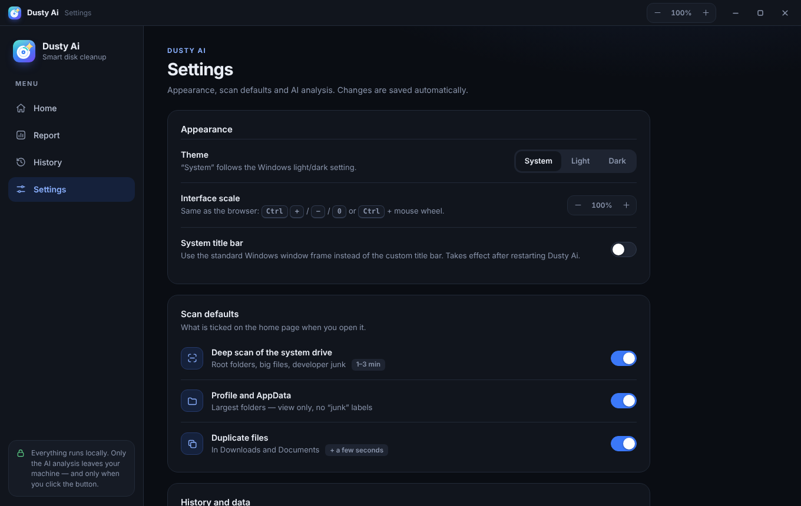
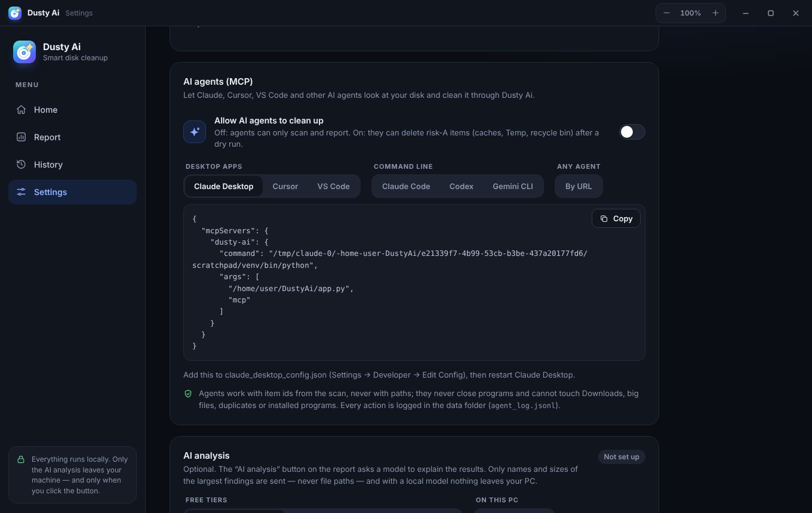

<div align="center">

# 🧹 Dusty Ai

**A Windows disk cleaner that explains _what_ is eating your space and _what happens_ if you delete it.**
Built for developers and local-AI folks — and usable by AI agents through MCP.

[**⬇ Download for Windows**](https://github.com/Maximusikk/DustyAi/releases/latest) · [Use with AI agents](#use-it-from-ai-agents-mcp) · [Safety](#safety)



</div>

## Why Dusty Ai

- **Every finding is explained.** Not “delete this folder?” but *what it is* and *what is restored afterwards* — risk **A** (safe), **B** (your call), **C** (manual only).
- **Knows what developers leave behind:** npm/pnpm/Gradle/NuGet/Cargo/pip caches, `.venv` and `node_modules`, Visual Studio and JetBrains leftovers — plus **AI-model folders** (Ollama, Hugging Face, LM Studio, PyTorch) and browser, game and messenger caches.
- **Careful by design.** Whitelist-only deletion, files in use are skipped (and you see *which program* holds them), programs are never closed behind your back, big files and duplicates need your confirmation.
- **Local and private.** No account, no telemetry. The only thing that can leave your PC is the optional AI summary — names and sizes only, and not at all with a local model.
- **Agent-ready.** One `DustyAi.exe` is also an [MCP](https://modelcontextprotocol.io) server: Claude, Cursor, VS Code and others can scan, explain and (if you allow it) clean up, with a dry run by default.

## Download

1. Get **`DustyAi.exe`** from the [latest release](https://github.com/Maximusikk/DustyAi/releases/latest) — one file, no installer, no Python needed.
2. Run it. Windows may show a **SmartScreen** warning (“Windows protected your PC”) because the app is not code-signed yet: click **More info → Run anyway**. The code is open and the exe is built by [GitHub Actions](.github/workflows/build-exe.yml) from this repository.
3. Pick the drives, press **Start scan**, review the report, tick what you no longer need.

Settings, history and keys live in `%LOCALAPPDATA%\DustyAi`. Deleting is permanent (nothing goes to the Recycle Bin) — that is why every item shows what it is and what comes back.

## Screenshots

| Home | Report |
|---|---|
|  |  |
| **Cleanup table** — risk, explanation, selection | **Dark theme** |
|  |  |
| **File in use** — which programs hold it, one line per app | **Settings** — theme, scale, AI provider, agent connection |
|  |  |

> Screenshots were taken in demo mode with sample data.

## Run from source

Windows, Python 3.10+: double-click `run.bat` — the app opens in its **own window** (Flask inside a native window via pywebview/WebView2).

```
pip install -r requirements.txt
python app.py             # app window
python app.py --browser   # same thing in a browser tab
```

Build a single `.exe` locally: `build.bat` → `dist\DustyAi.exe` (PyInstaller, with the icon from `assets/dustyai.ico`).
On Linux/macOS the app starts in demo mode with sample data and deletes nothing.

## Use it from AI agents (MCP)

Dusty Ai is an [MCP](https://modelcontextprotocol.io) server too, so Claude, Cursor, VS Code and other agents can check your disk and clean it. The same `DustyAi.exe` does it — no second program:

- **stdio:** the agent starts `DustyAi.exe mcp` itself (`--mcp` works too). **Settings → AI agents** has ready-to-copy configs (Claude Desktop, Claude Code, Cursor, VS Code) with your real path filled in.
- **By URL:** while the app is running, agents can use `http://127.0.0.1:5000/mcp` with the bearer token shown in Settings.



Tools: `disk_status`, `start_scan`, `scan_status`, `list_findings`, `explain_finding`, `clean`.

Safety: agents can only **look** until you switch on *Allow AI agents to clean up*. Even then they work with item ids (not paths), only for risk-A caches/Temp/recycle bin (risk B needs an explicit flag), `clean` is a dry run by default, programs are never closed, Downloads/big files/duplicates/programs are out of reach, and every action is logged to `agent_log.jsonl` in the data folder.

## Features

- **Custom window:** its own dark/light title bar with minimize/maximize/close buttons and a zoom control; **Ctrl + / − / 0** and **Ctrl + wheel** scale the interface like in a browser. The system title bar can be restored in Settings (or with `--native-frame`)
- **Settings:** theme (system/light/dark), interface scale, scan defaults, how many scans to keep, AI provider, AI-agent (MCP) connection, data folder. Settings, history and keys are stored in `%LOCALAPPDATA%\DustyAi` (change with the `DUSTYAI_DATA` variable)
- **Summary at a glance:** how much can be freed, how much of it is safe and how much free space the drive will have; the A/B/C tiles also filter the table
- **Drive selection:** C, D or several at once; the report can switch between drives
- **Whole-drive overview** (including the system drive, except the Windows folder): largest root folders (e.g. `C:\llama`), files of 500 MB+ with type detection (AI model, VM/WSL image, archive, dump…), `node_modules`/`venv`/`__pycache__`, recycle bin. Folders of installed programs are protected: `node_modules` inside Program Files and AppData is never offered for deletion
- **Big files** — a separate tab across all scanned drives: type, modification date, type filter. Any file can be deleted (with confirmation and a warning if it is part of a program or Python package); only the Windows folder and page/hibernation files are blocked
- **Risk filter** above the cleanup table (All / A / B / C) and a **“Select the safe ones”** button: it ticks everything in category A, and deletion still requires confirmation. The selection is collected in a floating bar “N items · X GB”
- **Downloads:** largest files with dates, an “old installer” marker, deletion of the selected ones
- **Profile and AppData overview:** largest folders with no “junk” labels — shows any program the catalog does not know about
- **Programs:** every installed program (not just the top 20), largest first; the **Uninstall…** button launches the standard Windows uninstaller
- Caches and junk from the catalog (`catalog.py`) with a description and an explanation of what gets restored
- **Smart Temp** — installer leftover folders (`*vs_*`, `*setup*`, `*installer*`, or >500 MB) older than 7 days
- **Python** — installations from `py -0p`, heavy packages, a warning if an installation is in use by a process (including an MCP server)
- **Duplicates** — files >50 MB in Downloads and Documents (MD5); one copy always remains
- **App icons** (from exe/registry), charts, a table with selection and batch deletion, categories A/B/C
- **Export** of the report to JSON and a **history** of scans (`scans/`, the last 3 on the home page, view-only)

## AI analysis (optional)

The **“✨ AI analysis”** button above the report tabs asks a model to explain the results in a few sentences: the main takeaway, what to delete first and what to leave alone. Choose the provider in **Settings → AI analysis**:

- **Free tiers:** Cloudflare Workers AI, Groq, OpenRouter, Google Gemini — each needs a free key (the Settings page links to where to get it)
- **On this PC:** Ollama (or any local OpenAI-compatible server) — no key, nothing leaves your computer
- **Your own key:** OpenAI (ChatGPT), Anthropic (Claude), or any OpenAI-compatible endpoint (LM Studio, DeepSeek, Mistral, Together…)

The **Test** button checks that the provider answers. Model names are editable, so you can pick a bigger one. Keys are stored only on your computer (`ai.json` in the data folder) and never shown again.

> **Privacy.** This is the only thing the app can send out, and only when you click. It sends names and sizes of up to seven of the largest findings (grouped as “safe / your call / manual only”) and the total amount of safe junk — **no file paths**. With a local model nothing is sent anywhere.

## Safety

- The deletion path is taken only from `catalog.py`; the client sends just an `id` from the whitelist (`DELETABLE_IDS`), otherwise 403.
- Caches are deleted right away, even if an IDE or browser is open. If some files are in use, the app shows **which programs hold them** (Windows Restart Manager) and you decide: close the selected ones and retry, retry without closing, or leave as is. Programs are first asked to close gently (like clicking the X); forced termination is a separate checkbox. System processes cannot be closed, and only programs from the server-determined blocker list can be. The only hard block is cleaning Temp during an installation (`vs_installer`).
- The system Temp and protected folders need administrator rights — use the “🛡 Run as administrator” button in the sidebar.
- Only the cache contents/specific folder is deleted, never a program's root.
- Double confirmation in the UI (resets after 4 s).
- Dynamic items (Temp, duplicates) are re-validated before deletion: path inside Temp/Downloads/Documents, age, presence of an identical copy.
- AI models and Playwright browsers are shown but can only be deleted manually.

## Layout

`mcp_server.py` — MCP server for AI agents · `settings.py` — user settings and data folder · `winchrome.py` — move/resize of the frameless window · `app.py` — Flask, scan, `/delete`, history, export · `scanners.py` — Temp, Python, duplicates · `util.py` — PowerShell and sizes · `catalog.py`, `catalog_extra.py` — catalog of locations · `templates/` — UI · `assets/` — logo and app icon

### Interface

- `templates/base.html` — shell (sidebar, modal window, notifications) and shared JS helpers
- `templates/_base.css` — design system: color tokens of the light and dark themes, buttons, cards, tabs, forms. Colors and sizes are changed in the `:root` block at the top of the file
- `templates/_icons.html` — SVG icon sprite and brand mark; use as `<svg class="ic"><use href="#i-name"/></svg>`
- `templates/index.html`, `report.html`, `history.html` — pages; the page styles and script live in the same file
- See the interface without Windows: `python app.py --browser` (demo mode, nothing is deleted)

## License

[MIT](LICENSE) © 2026 Maximusikk
